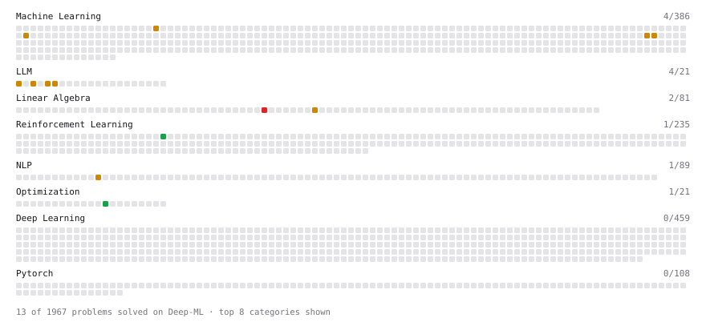

# Deep-ML

My machine learning practice from [Deep-ML](https://www.deep-ml.com). Every solution here was written by hand.

**20** solved · 19 problems · 0 labs · 1 math

[**Browse the interactive portfolio**](https://Vzaldat.github.io/deep-ml/) to replay this filling in over time.

## Problems

| | Difficulty | Solved | |
| --- | --- | --- | --- |
| [Exact Match Score with Normalization](https://www.deep-ml.com/problems/325) | easy | 2026-11-10 | [solution](problems/0325-exact-match-score-with-normalization) |
| [Learning Rate Range Finder for Linear Regression](https://www.deep-ml.com/problems/990) | easy | 2026-10-29 | [solution](problems/0990-learning-rate-range-finder-for-linear-regression) |
| [Macro-Average Accuracy Across Benchmark Subtasks](https://www.deep-ml.com/problems/797) | easy | 2026-11-10 | [solution](problems/0797-macro-average-accuracy-across-benchmark-subtasks) |
| [Pass@k and Majority Voting Evaluation Metrics](https://www.deep-ml.com/problems/226) | easy | 2026-11-02 | [solution](problems/0226-pass-k-and-majority-voting-evaluation-metrics) |
| [BLEU Score for Text Generation](https://www.deep-ml.com/problems/321) | medium | 2026-11-11 | [solution](problems/0321-bleu-score-for-text-generation) |
| [Boxed Answer Extraction for Math Benchmarks](https://www.deep-ml.com/problems/318) | medium | 2026-11-06 | [solution](problems/0318-boxed-answer-extraction-for-math-benchmarks) |
| [Cholesky Decomposition](https://www.deep-ml.com/problems/334) | medium | 2026-10-29 | [solution](problems/0334-cholesky-decomposition) |
| [Code Execution Verifier for Programming Benchmarks](https://www.deep-ml.com/problems/324) | medium | 2026-11-10 | [solution](problems/0324-code-execution-verifier-for-programming-benchmarks) |
| [Elo Rating System for Model Comparison](https://www.deep-ml.com/problems/315) | medium | 2026-11-10 | [solution](problems/0315-elo-rating-system-for-model-comparison) |
| [Implement Gradient Boosting Regressor Step](https://www.deep-ml.com/problems/344) | medium | 2026-10-29 | [solution](problems/0344-implement-gradient-boosting-regressor-step) |
| [Implement Gradient Descent Variants with MSE Loss](https://www.deep-ml.com/problems/47) | medium | 2026-10-29 | [solution](problems/0047-implement-gradient-descent-variants-with-mse-loss) |
| [Implementing ROUGE Score](https://www.deep-ml.com/problems/152) | medium | 2026-11-11 | [solution](problems/0152-implementing-rouge-score) |
| [Mini-Batch Gradient Descent Step for Linear Regression](https://www.deep-ml.com/problems/803) | medium | 2026-10-29 | [solution](problems/0803-mini-batch-gradient-descent-step-for-linear-regression) |
| [MMLU Letter-Matching Evaluation](https://www.deep-ml.com/problems/326) | medium | 2026-11-06 | [solution](problems/0326-mmlu-letter-matching-evaluation) |
| [MMLU Log-Probability Scoring](https://www.deep-ml.com/problems/316) | medium | 2026-11-05 | [solution](problems/0316-mmlu-log-probability-scoring) |
| [Pairwise Preference Judge for LLM Comparison](https://www.deep-ml.com/problems/323) | medium | 2026-11-08 | [solution](problems/0323-pairwise-preference-judge-for-llm-comparison) |
| [Stochastic Gradient Descent Step for Linear Regression](https://www.deep-ml.com/problems/802) | medium | 2026-10-29 | [solution](problems/0802-stochastic-gradient-descent-step-for-linear-regression) |
| [Codeforces Elo Estimation from Sampled Submissions](https://www.deep-ml.com/problems/1548) | hard | 2026-11-10 | [solution](problems/1548-codeforces-elo-estimation-from-sampled-submissions) |
| [QR Decomposition](https://www.deep-ml.com/problems/201) | hard | 2026-10-29 | [solution](problems/0201-qr-decomposition) |

## Math

| | Difficulty | Solved | |
| --- | --- | --- | --- |
| [Why Minibatches: Gradient Variance vs Batch Size](https://www.deep-ml.com/math-problems/130) | easy | 2026-10-29 | [solution](math/0130-why-minibatches-gradient-variance-vs-batch-size) |

---

_This file is regenerated by Deep-ML on every push._
