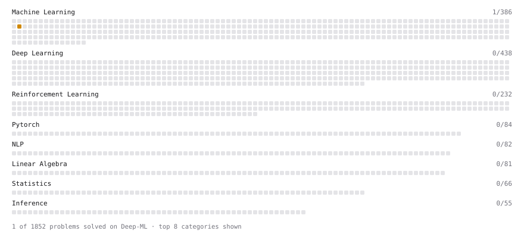

# Deep-ML

My machine learning practice from [Deep-ML](https://www.deep-ml.com). Every solution here was written by hand.

**4** solved · 3 problems · 0 labs · 1 math

[**Browse the interactive portfolio**](https://Vzaldat.github.io/deep-ml/) to replay this filling in over time.

## Problems

| | Difficulty | Solved | |
| --- | --- | --- | --- |
| [Cholesky Decomposition](https://www.deep-ml.com/problems/334) | medium | 2026-10-29 | [solution](problems/0334-cholesky-decomposition) |
| [Implement Gradient Boosting Regressor Step](https://www.deep-ml.com/problems/344) | medium | 2026-10-29 | [solution](problems/0344-implement-gradient-boosting-regressor-step) |
| [QR Decomposition](https://www.deep-ml.com/problems/201) | hard | 2026-10-29 | [solution](problems/0201-qr-decomposition) |

## Math

| | Difficulty | Solved | |
| --- | --- | --- | --- |
| [Why Minibatches: Gradient Variance vs Batch Size](https://www.deep-ml.com/math-problems/130) | easy | 2026-10-29 | [solution](math/0130-why-minibatches-gradient-variance-vs-batch-size) |

---

_This file is regenerated by Deep-ML on every push._
